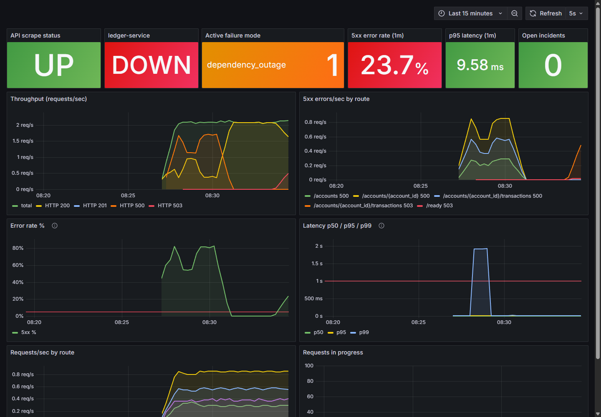
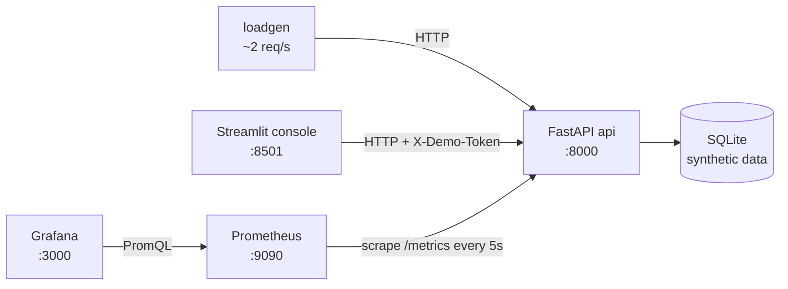
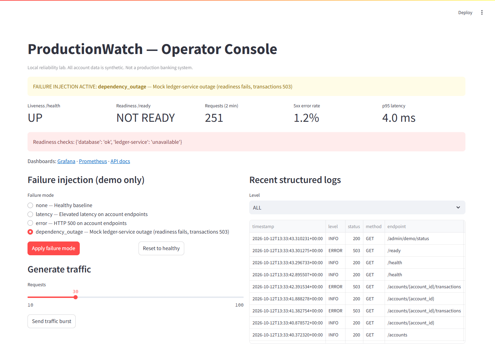
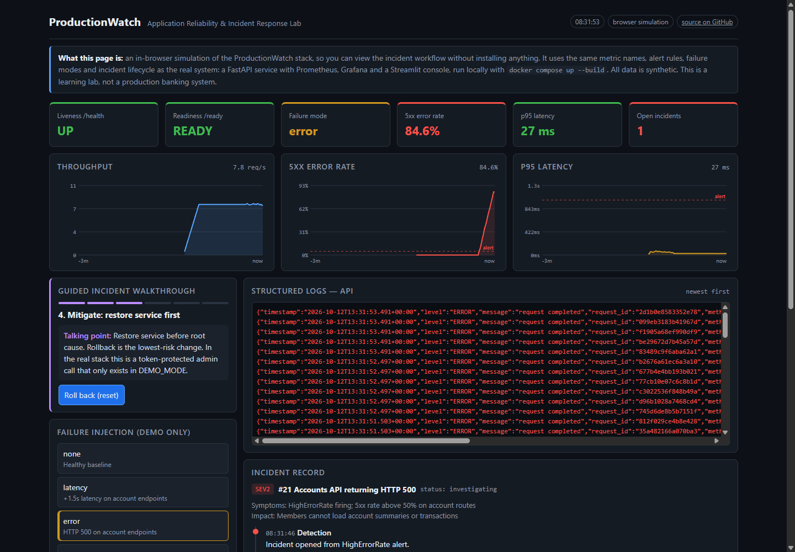

# ProductionWatch — Application Reliability & Incident Response Lab

[](https://github.com/ArmandoSNHU/ProductionWatch/actions/workflows/ci.yml)

**Live dashboard (browser simulation): https://armandosnhu.github.io/ProductionWatch/**

ProductionWatch is a small, fully local lab for practicing Tier 2 application support. It's built around a fictional accounts-and-transactions API, instrumented the way production services are: structured logs with request IDs, Prometheus metrics, Grafana dashboards, alert rules, and liveness/readiness probes. You can inject a controlled failure, watch it surface in the monitoring, triage it, restore service, verify recovery, and record the incident from detection to follow-up.

> **All data is synthetic.** Accounts use `DEMO-` references and "Test Member" aliases. This is a personal learning lab that runs on your machine. It is not a production banking platform, and it has no connection to any real financial service.



## What it demonstrates

| Skill | Where to look |
|---|---|
| Monitoring & observability | Prometheus metrics (`app/metrics.py`), Grafana dashboard, alert rules (`prometheus/alert_rules.yml`) |
| Log/metric correlation | JSON logs with `request_id`, endpoint, status, latency and active failure mode; `X-Request-ID` on every response |
| Liveness vs readiness | `/health` stays green while `/ready` fails on a dependency outage |
| Incident management | Severity, timeline (detection → triage → mitigation → recovery → follow-up), required verification and follow-up |
| Safe service restoration | Token-protected, opt-in failure injection that never modifies data; one-call reset |
| Containers | Five-service Docker Compose stack with healthchecks and provisioned dashboards |
| Testing | 34 pytest tests covering API, auth, failure modes, metrics, logs and the full recovery flow; GitHub Actions CI |

## Architecture



Details, endpoint table, metric names and design tradeoffs: [docs/ARCHITECTURE.md](docs/ARCHITECTURE.md).

## Quick start

Requirements: Docker Desktop (or Docker Engine with Compose v2).

```bash
git clone https://github.com/ArmandoSNHU/ProductionWatch.git
cd ProductionWatch
cp .env.example .env          # then change DEMO_TOKEN
docker compose up --build
```

The stack also starts without `.env`, using the defaults from `.env.example`. Change the token if anything else on your network can reach these ports.

| Service | URL | Notes |
|---|---|---|
| API | http://localhost:8000 | Interactive docs at http://localhost:8000/docs |
| Operator console | http://localhost:8501 | Status, failure injection, logs, incidents |
| Grafana | http://localhost:3000 | Opens on the ProductionWatch dashboard (anonymous view; admin/admin to edit) |
| Prometheus | http://localhost:9090 | Alerts at http://localhost:9090/alerts, targets at /targets |

## Demo commands

```bash
export DEMO_TOKEN=change-me-local-demo-token   # PowerShell: $env:DEMO_TOKEN="..."

curl -s localhost:8000/health
curl -s localhost:8000/ready
curl -s localhost:8000/accounts

# Inject a failure: none | latency | error | dependency_outage
curl -s -X POST localhost:8000/admin/demo/failure \
  -H "X-Demo-Token: $DEMO_TOKEN" -H "Content-Type: application/json" \
  -d '{"mode":"error"}'

curl -i localhost:8000/accounts                       # HTTP 500 with request_id
docker compose logs api --since 2m | grep '"level": "ERROR"'
curl -s "localhost:8000/ops/summary?window_seconds=60"

# Restore
curl -s -X POST localhost:8000/admin/demo/reset -H "X-Demo-Token: $DEMO_TOKEN"
```

Run a complete scripted incident (inject → open → triage → restore → verify → resolve → close):

```bash
bash scripts/run_incident_scenario.sh 90
```

The five-minute interview walkthrough is in [docs/INTERVIEW_DEMO.md](docs/INTERVIEW_DEMO.md).

## Failure modes

| Mode | Effect | Where it shows |
|---|---|---|
| `latency` | +1.5s on account endpoints (`DEMO_LATENCY_SECONDS`) | p95/p99 panels, `HighLatencyP95` alert |
| `error` | Account endpoints return HTTP 500 | 5xx panels, `HighErrorRate` alert, ERROR logs |
| `dependency_outage` | Mock `ledger-service` down: `/ready` 503, transactions 503, account reads still 200 | `ledger-service` tile, `DependencyDown` alert, partial error rate |

Safety rails: failure injection requires `DEMO_MODE=true` **and** a matching `X-Demo-Token`. It is off by default outside Compose, it never writes to the database, and the token is never logged. This token is a guard against accidental triggering, not real authentication. Keep the stack on localhost.

## Screenshots

| Operator console | Browser dashboard (GitHub Pages) |
|---|---|
|  |  |

## Running tests

```bash
python -m venv .venv
.venv/Scripts/activate        # macOS/Linux: source .venv/bin/activate
pip install -r requirements-dev.txt
pytest -q
```

Each test builds its own app with a temporary SQLite database, so nothing touches `data/` and tests can run in any order.

Running the API without Docker:

```bash
DEMO_MODE=true DEMO_TOKEN=local uvicorn app.main:app --reload
API_URL=http://localhost:8000 DEMO_TOKEN=local streamlit run console/dashboard.py
```

## GitHub Pages dashboard

`site/index.html` is a self-contained page deployed by `.github/workflows/pages.yml`. GitHub Pages can't run Python, so the page simulates the stack in the browser. It uses the same metric semantics, alert rules, failure modes and incident lifecycle, and adds a guided walkthrough with talking points. Alert `for:` windows are shortened so the demo moves quickly. The Docker stack is the real system.

## Repository layout

```text
app/            FastAPI service (routes, middleware, metrics, logging, incidents, demo controls)
console/        Streamlit operator console
scripts/        Traffic generator, scripted incident, Grafana dashboard generator
tests/          pytest suite
prometheus/     Scrape config and alert rules
grafana/        Provisioned datasource and dashboard JSON
site/           GitHub Pages dashboard (static simulation)
docs/           Architecture, interview demo script, incident runbook, troubleshooting
```

## Troubleshooting

Common problems such as ports, tokens, "No data" in Grafana, and resetting the database are covered in [docs/TROUBLESHOOTING.md](docs/TROUBLESHOOTING.md). The incident procedure itself is in [docs/INCIDENT_RUNBOOK.md](docs/INCIDENT_RUNBOOK.md).

## Design tradeoffs (short version)

- SQLite over Postgres: zero setup, single instance, at the cost of realistic database failure modes.
- In-app failure injection over chaos tooling: deterministic and safe to demo, but the failures are simulated.
- Shared demo token over an auth framework: prevents accidents but isn't identity or authorization.
- No Alertmanager or ticketing integration: alerts are visible in Prometheus, and incidents live in the app's own SQLite table rather than ServiceNow.

## About

Built by Armando Gomez as a hands-on lab for application support and incident response practice, with AI-assisted development. I reviewed, ran and tested the code, and I use it to practice the workflows. The design draws on my experience troubleshooting enterprise SaaS, API integrations and performance issues.
