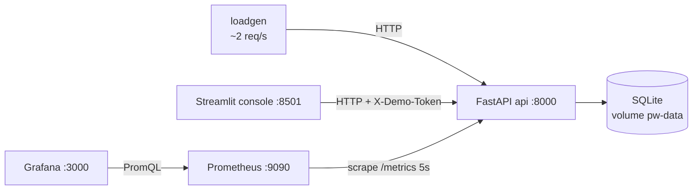

# Architecture

## Services

| Service | Port | Image / source | Purpose |
|---|---|---|---|
| `api` | 8000 | `Dockerfile.api`, `app/` | Synthetic accounts REST API, probes, incident records, failure injection, `/metrics` |
| `console` | 8501 | `Dockerfile.console`, `console/dashboard.py` | Streamlit operator console: status, failure controls, logs, incidents |
| `loadgen` | – | `Dockerfile.api`, `scripts/generate_traffic.py` | About 2 req/s of steady traffic so dashboards always have data |
| `prometheus` | 9090 | `prom/prometheus:v2.55.1` | Scrapes `api:8000/metrics` every 5s, evaluates `prometheus/alert_rules.yml` |
| `grafana` | 3000 | `grafana/grafana:11.3.1` | Provisioned datasource and "ProductionWatch — Service Health" dashboard |

GitHub Pages (`site/index.html`) is a separate static page. It simulates this stack in the browser for people who can't run Docker. It shares no code with the API.

## API modules (`app/`)

| Module | Responsibility |
|---|---|
| `main.py` | `create_app(settings)` factory, probes, account routes, `/metrics`, `/ops/*` |
| `config.py` | `Settings` read from environment variables |
| `database.py` | Engine and session factory per app instance (tests get an isolated DB) |
| `models.py` | `Account`, `Transaction`, `Incident`, `IncidentEvent` |
| `schemas.py` | Pydantic request/response models and the allowed enum values |
| `seed.py` | Five synthetic accounts with fixed-seed transactions; idempotent |
| `middleware.py` | Request ID, timing, metrics and one structured access log per request |
| `logging_utils.py` | JSON log formatter, key redaction, in-memory recent-log buffer |
| `metrics.py` | Prometheus metric definitions |
| `demo_controls.py` | Failure state, token and demo-mode guards, `/admin/demo/*` routes |
| `incident_routes.py` | `/incidents` lifecycle |

## Endpoint surface

| Method | Path | Auth | Notes |
|---|---|---|---|
| GET | `/health` | – | Liveness only; never checks dependencies |
| GET | `/ready` | – | Readiness: database + mock `ledger-service`; 503 when not ready |
| GET | `/accounts` | – | Affected by `latency` and `error` modes |
| GET | `/accounts/{account_id}` | – | Affected by `latency` and `error` modes |
| GET | `/accounts/{account_id}/transactions` | – | Also 503 in `dependency_outage` mode |
| GET | `/metrics` | – | Prometheus exposition format |
| GET | `/ops/summary` | – | Requests, 5xx rate and p95 over a recent window (from log buffer) |
| GET | `/ops/logs` | token | Recent structured logs, newest first; `?level=ERROR` |
| GET | `/admin/demo/status` | token + DEMO_MODE | Current failure mode |
| POST | `/admin/demo/failure` | token + DEMO_MODE | `{"mode": "none" \| "latency" \| "error" \| "dependency_outage"}` |
| POST | `/admin/demo/reset` | token + DEMO_MODE | Back to `none` |
| GET | `/incidents`, `/incidents/{incident_id}` | – | Includes timeline events |
| POST | `/incidents` | token | Create; adds a `detection` event |
| POST | `/incidents/{incident_id}/events` | token | Timeline note, optional status `investigating` / `mitigated` |
| POST | `/incidents/{incident_id}/resolve` | token | Requires `mitigation` and `resolution_verification` |
| POST | `/incidents/{incident_id}/close` | token | Only from `resolved`; requires `follow_up` |

Token = `X-Demo-Token` header that matches `DEMO_TOKEN`. If `DEMO_TOKEN` is empty, every token-protected route returns 503.

## Metrics

| Metric | Type | Labels |
|---|---|---|
| `pw_http_requests_total` | counter | `method`, `route`, `status` |
| `pw_http_request_duration_seconds` | histogram | `method`, `route` |
| `pw_http_requests_in_progress` | gauge | – |
| `pw_http_errors_total` | counter | `route`, `status` (5xx only) |
| `pw_demo_failure_mode` | gauge | `mode` (1 = active) |
| `pw_dependency_up` | gauge | `dependency` |
| `pw_open_incidents` | gauge | – |

`route` is the route template (`/accounts/{account_id}`), not the raw path, which keeps label cardinality bounded. `/metrics`, `/ops/summary` and `/ops/logs` are excluded from request metrics and logs so scrapes and console polling don't distort the SLIs. `/admin/*` calls are logged as `operator action` for audit but also kept out of the SLIs.

## Design tradeoffs

- **SQLite instead of Postgres.** No extra container and nothing to configure. It's enough for a single-instance demo. Tradeoff: no concurrent writers and no realistic DB failure modes.
- **Failure injection lives inside the app.** It's simple and deterministic, and it never touches data. A real environment would use chaos tooling or feature flags, and the failure would come from a real fault.
- **Shared-secret token, not real auth.** This only keeps the admin routes from being triggered by accident. It isn't an identity system, there's no rate limiting, and it's meant for localhost only.
- **In-memory log buffer for the console.** This stands in for Splunk/Loki/Datadog. It resets on restart and is per-process. Container stdout (`docker compose logs api`) holds the same JSON lines.
- **`/ops/summary` vs Prometheus.** The console's summary comes from the log buffer so it works even when Prometheus is down. Grafana's numbers come from Prometheus. They can differ slightly because their windows differ.
- **No Alertmanager.** Alerts show as pending/firing in the Prometheus UI. Routing to on-call (PagerDuty, ServiceNow) is out of scope.
